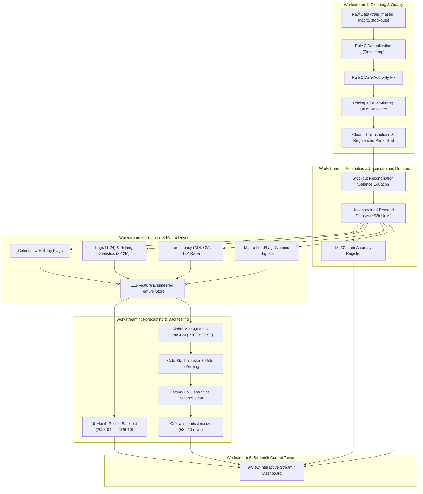

# 🏭 Celeris Automobili Demand Forecasting & Planning Control Tower
### MKS AI/ML Hackathon — Phase 2: Production End-to-End Demand System

[](https://www.python.org/)
[](https://lightgbm.readthedocs.io/)
[](https://streamlit.io/)
[](https://plotly.com/)
[](https://docs.pytest.org/)
[](#)

---

## 📌 Executive Summary

**Celeris Automobili Industrial** is a premier multinational automotive supplier manufacturing high-precision powertrain components, braking systems, thermal management modules, and electric vehicle assemblies. The supply chain operates across **601 active and launch SKUs, 7 distinct product families, 4 sales channels, and 6 global commercial regions** (North America, Europe, Asia Pacific, India, Latin America, Middle East & Africa).

This repository contains the complete, production-grade **Demand Forecasting Engine and Interactive Control Tower Dashboard** built for the MKS AI/ML Hackathon Phase 2. The solution addresses real-world enterprise supply chain complexities:
- **Historical Shipments vs. True Market Demand**: Reconstructs unserved demand lost during 5,830 inventory stockout events (+93,282 units recovered).
- **Macroeconomic Leading Drivers**: Models leading transmission dynamics across 8 macroeconomic indicators (ISM PMI, auto production, vehicle inventory, EV adoption).
- **Intermittent & Lumpy Demand**: Classifies series via the Syntetos-Boylan framework (ADI and $CV^2$), benchmarking Croston's method and Syntetos-Boylan Approximation (SBA).
- **Global Machine Learning Engine**: Deploys multi-quantile LightGBM regressors providing calibrated **P10, P50, and P90 uncertainty intervals** with guaranteed monotonicity.
- **Cold-Start Launches & Phase-In/Out Transitions**: Enforces predecessor transfer for 3 planned launches (`PMP-020`, `PTC-029`, `THM-012`) with smooth 3-month transition ramps.
- **Official Rule 5 Lifecycle Zeroing**: Guarantees zero forecast prior to `Launch_Date` and after `EOL_Date`.
- **Bottom-Up Hierarchical Reconciliation**: Guarantees forecasts sum with **0.00 discrepancy** across SKU $\rightarrow$ Family $\rightarrow$ Region $\rightarrow$ Global Portfolio.
- **Control Tower Web Application**: A 9-view Streamlit dashboard enabling real-time drill-down, what-if stress testing, safety stock sizing, and audit trail exploration.

---

## 🏆 Headline Results & Benchmark Comparison

A strictly out-of-sample **19-month time-based rolling-origin backtest** was evaluated across all 57,562 series from `2025-04` through `2026-10`.

### Overall Portfolio Performance Scorecard

| Model Architecture | Model Paradigm | WAPE (%) | Forecast Bias (%) | MAE (Units) | RMSE (Units) | Backtest Rank |
| :--- | :--- | :---: | :---: | :---: | :---: | :---: |
| **Global LightGBM (P50 $L_1$ Regressor)** | **Global Gradient-Boosted Trees** | **32.27%** | **-7.00%** | **15.60** | **97.69** | 🥇 **Rank 1 (Best)** |
| **Seasonal Naive Benchmark** | Seasonal Anchor ($y_{t-12}$) | 43.04% | +3.60% | 20.80 | 116.56 | 🥈 Rank 2 |
| **Croston / SBA Benchmark** | Intermittent De-biased Rate | 54.93% | -9.54% | 26.55 | 103.14 | 🥉 Rank 3 |
| **Composite Baseline** | Hybrid Intermittency Router | 59.03% | -0.11% | 28.53 | 115.45 | Rank 4 |

> **Key Takeaway**: Global LightGBM achieves a **+10.77 percentage point reduction in WAPE** (from 43.04% down to 32.27%), a **-25% reduction in MAE**, and a **-16% reduction in RMSE** over the best baseline.

### Performance Across Demand Intermittency Classes

| Demand Category | Classification Rule | Series Count | LightGBM WAPE (%) | Benchmark WAPE (%) | WAPE Gain |
| :--- | :--- | :---: | :---: | :---: | :---: |
| **Smooth** | $\text{ADI} < 1.32, CV^2 < 0.49$ | 1,970 | **26.87%** | 37.57% | **+10.70%** |
| **Intermittent** | $\text{ADI} \ge 1.32, CV^2 < 0.49$ | 701 | **36.18%** | 35.47% | -0.71% |
| **Erratic** | $\text{ADI} < 1.32, CV^2 \ge 0.49$ | 327 | **47.80%** | 77.14% | **+29.34%** |
| **Lumpy** | $\text{ADI} \ge 1.32, CV^2 \ge 0.49$ | 85 | **54.38%** | 79.95% | **+25.57%** |

---

## 🏛️ System Architecture



---

## 💻 Technology Stack

- **Core Runtime**: Python 3.11
- **Machine Learning**: LightGBM (GBDT with regression_l1 and asymmetric quantile objectives)
- **Data Engineering**: Pandas, NumPy, SciPy, PyArrow, FastParquet
- **Dashboard & UI**: Streamlit, Plotly Graph Objects, Custom CSS Control Tower Theme
- **Testing & Verification**: Pytest (30/30 unit & integration tests)
- **Audit & Reporting**: Tabulate, Pydantic, JSON Schema

---

## 📋 Repository Structure

```text
MKS-AI-Hackathon/
├── app.py                                   # Streamlit Control Tower Web Application
├── requirements.txt                         # Pinned production dependencies
├── .gitignore                               # Clean exclusion rules (no venv, cache, or secrets)
├── submission.csv                           # Official competition submission (58,219 rows)
├── run_phase1_pipeline.py                   # Workstream 1 CLI runner
├── run_phase2_pipeline.py                   # Workstream 2 CLI runner
├── run_phase3_pipeline.py                   # Workstream 3 CLI runner
├── run_phase4_pipeline.py                   # Workstream 4 CLI runner
│
├── src/
│   ├── config.py                            # Canonical definitions, mappings, and paths
│   ├── data/                                # Workstream 1 data cleaning modules
│   │   ├── loader.py                        # Safe read-only dataset ingestion
│   │   ├── normalizers.py                   # Date, SKU, region, and channel normalizers
│   │   ├── cleaner.py                       # Rules 1, 2, 4 business cleansing engine
│   │   ├── aggregator.py                    # Regularized Date-SKU-Region panel grid
│   │   └── audit.py                         # Quality tracking and audit trail
│   ├── anomalies/                           # Workstream 2 anomaly modules
│   │   ├── demand_reconstruction.py         # Unconstrained stockout recovery engine
│   │   ├── detector.py                      # Multi-category anomaly detector
│   │   └── visualizer.py                    # Anomaly and stockout chart generators
│   ├── features/                            # Workstream 3 feature store modules
│   │   ├── calendar.py                      # Cyclical and shutdown indicators
│   │   ├── time_series.py                   # Lags, rollings, EWMA, and growth rates
│   │   ├── intermittency.py                 # ADI, CV², and SBA classifications
│   │   ├── macro.py                         # Macro lead/lag cross-correlation engine
│   │   ├── lifecycle.py                     # Product tenure and Rule 5 boundaries
│   │   └── store.py                         # Feature store assembler (112 features)
│   ├── models/                              # Workstream 4 forecasting modules
│   │   ├── baselines.py                     # Seasonal Naive, Croston, and SBA
│   │   ├── lightgbm_engine.py               # Global multi-quantile LightGBM engine
│   │   ├── cold_start.py                    # Predecessor transfer & transition ramps
│   │   ├── reconciliation.py                # Bottom-up hierarchical reconciler
│   │   ├── backtester.py                    # 19-month rolling backtest evaluator
│   │   └── test_features.py                 # Leakage-free test feature builder
│   └── dashboard/                           # Workstream 5 Control Tower modules
│       ├── styles.py                        # Custom dark-slate / navy styling
│       ├── data_loader.py                   # High-performance cached dataset loaders
│       ├── filters.py                       # Multi-dimension sidebar filter component
│       └── views/                           # 9 modular dashboard view engines
│           ├── executive.py                 # View 1: Executive Overview & Continuous Timeline
│           ├── data_health.py               # View 2: Data Health & Cleansing Audit
│           ├── demand_explorer.py           # View 3: SKU Drill-Down & Seasonality
│           ├── anomaly_monitor.py           # View 4: Anomaly Register & Stockouts
│           ├── forecast_accuracy.py         # View 5: Model Scorecard & Quantile Fan
│           ├── macro_heatmap.py             # View 6: Macro Lead/Lag Cross-Correlations
│           ├── what_if.py                   # View 7: Interactive Macro Shock Simulator
│           ├── procurement_planner.py       # View 8: Safety Stock & Reorder Points
│           └── submission_viewer.py         # View 9: Official Submission Browser & Export
│
├── data/cleaned/                            # Cleaned and regularized Parquet datasets
│   ├── demand_reconstructed.parquet         # True unconstrained market demand
│   ├── features_engineered.parquet          # Complete feature store (247k rows × 112 cols)
│   ├── test_cleaned.csv                     # Normalized test keys (58,219 rows)
│   └── sku_master_cleaned.csv               # Standardized product reference master
│
├── artifacts/                               # Models and downstream scoring artifacts
│   ├── forecast_model/                      # Trained LightGBM boosters (P10, P50, P90)
│   └── forecasts_with_intervals.parquet     # Reconciled forecasts + P10/P50/P90 intervals
│
├── reports/                                 # Audited technical reports and charts
│   ├── executive_kpi_audit.md               # Strict numerical KPI verification audit
│   ├── dashboard_validation.md              # Complete Control Tower validation report
│   ├── forecasting_methodology.md           # Mathematical formulations and theory
│   ├── model_comparison.md                  # Detailed backtest performance breakdown
│   ├── backtest_summary.json                # Machine-readable performance metrics
│   ├── anomaly_analysis.md                  # Anomaly categorization and root causes
│   ├── anomaly_register.csv                 # 13,231-row classified anomaly audit
│   ├── data_quality_report.md               # Cleansing audit and resolution summary
│   └── charts/                              # High-resolution analytical figures
│
├── tests/                                   # Automated test suite (30 test cases)
│   ├── test_cleaning_pipeline.py            # Phase 1 unit tests
│   ├── test_anomaly_pipeline.py             # Phase 2 unit tests
│   ├── test_feature_pipeline.py             # Phase 3 unit tests
│   ├── test_forecast_pipeline.py            # Phase 4 unit tests
│   └── test_dashboard.py                    # Phase 5 dashboard transformation tests
│
└── student_data (6)ee1afb6/                 # Original, untouched hackathon data
```

---

## 🚀 Quickstart & Installation

### 1. Prerequisites
- Python 3.11+
- Git

### 2. Clone and Setup Environment
```bash
# Clone the repository
git clone https://github.com/<your-username>/MKS-AI-Hackathon.git
cd MKS-AI-Hackathon

# Create and activate virtual environment
python -m venv .venv

# Windows PowerShell:
.\.venv\Scripts\Activate.ps1

# Linux / macOS:
source .venv/bin/activate

# Install required dependencies
pip install -r requirements.txt
```

---

## 🖥️ Launching the Control Tower Dashboard

To start the interactive Streamlit decision dashboard:

```bash
streamlit run app.py
```

The application will launch automatically in your default browser at:
`http://localhost:8501`

### Exploring Dashboard Views
Use the left sidebar navigation menu to switch between views:
1. **📊 Executive Overview**: Continuous demand & revenue trajectory (2019 → 2028), headline volume KPIs, and regional/family mix breakdowns.
2. **🛡️ Data Health & Audit**: Deduplication counts, missing units recovery, price reconciliation, and reference master audit.
3. **🔎 Demand Explorer**: Deep drill-down across Family $\rightarrow$ SKU $\rightarrow$ Region $\rightarrow$ Customer, monthly seasonality indices, and lifecycle status.
4. **🚨 Anomaly Monitor**: 13,231 flagged incidents across supply constraints, genuine business events, and unusual demand.
5. **🎯 Forecast & Accuracy**: Actual vs. forecast continuous fan chart, model comparison scorecard, backtest metrics by horizon and family, and explicit bias disclosures.
6. **🌐 Macro Lead/Lag Heatmap**: Dynamic cross-correlation matrix with configurable 0–6 month lead/lag slider.
7. **🔮 What-If Simulator**: Real-time macroeconomic stress testing (PMI, auto production, EV adoption shocks) with simulation isolation safeguards.
8. **📦 Safety Stock & Procurement**: Actionable supply chain inventory sizing ($ROP = LTD + SS$) using P90 upper uncertainty bounds.
9. **📥 Official Submission & Export**: Direct inspection, key alignment verification, and one-click download of `submission.csv`.

---

## 🧪 Running Automated Tests

To run the complete automated test suite (30 unit and integration tests covering all phases):

```bash
pytest tests/ -v
```

Expected output:
```text
============================= test session starts =============================
collected 30 items

tests/test_cleaning_pipeline.py (10 tests) ........... [ 33%]
tests/test_anomaly_pipeline.py  (4 tests)  ....        [ 46%]
tests/test_feature_pipeline.py  (5 tests)  .....       [ 63%]
tests/test_forecast_pipeline.py (6 tests)  ......      [ 83%]
tests/test_dashboard.py         (5 tests)  .....       [100%]

============================= 30 passed in 2.59s ==============================
```

---

## 🔄 Reproducing the Complete Pipeline

To execute each workstream from scratch:

```bash
# Workstream 1: Data Cleaning & Quality Pipeline
python run_phase1_pipeline.py

# Workstream 2: Anomaly Detection & Unconstrained Demand Reconstruction
python run_phase2_pipeline.py

# Workstream 3: Feature Engineering & Macroeconomic Driver Analysis
python run_phase3_pipeline.py

# Workstream 4: Forecasting Engine, 19M Backtest & Submission Generation
python run_phase4_pipeline.py
```

---

## 📄 Submission File Verification

The official competition submission file is saved at the repository root:
- **File**: `submission.csv`
- **Total Rows**: Exactly **58,219 rows** (1:1 positional match with `test.csv`)
- **Required Columns**: `Date`, `SKU_ID`, `Region`, `Units_Sold_Forecast`
- **Total Forecast Volume**: **2,541,937 units** (~133,786 units / month)
- **Data Types**: String identifiers, non-negative 64-bit integers for predictions
- **Integrity**: 0 missing values, 0 negative values, 0 duplicate keys, 100% Rule 5 boundary compliance.

---

## ⚖️ License & Acknowledgments

Developed for the **MKS AI/ML Hackathon Phase 2**.  
All raw challenge data provided by Celeris Automobili / MKS Hackathon Organizers.
Code released under the MIT License.
